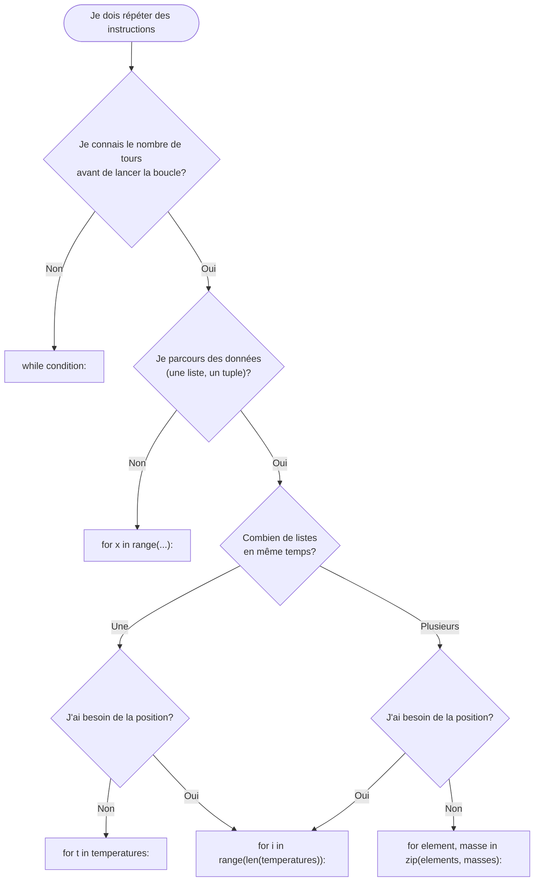
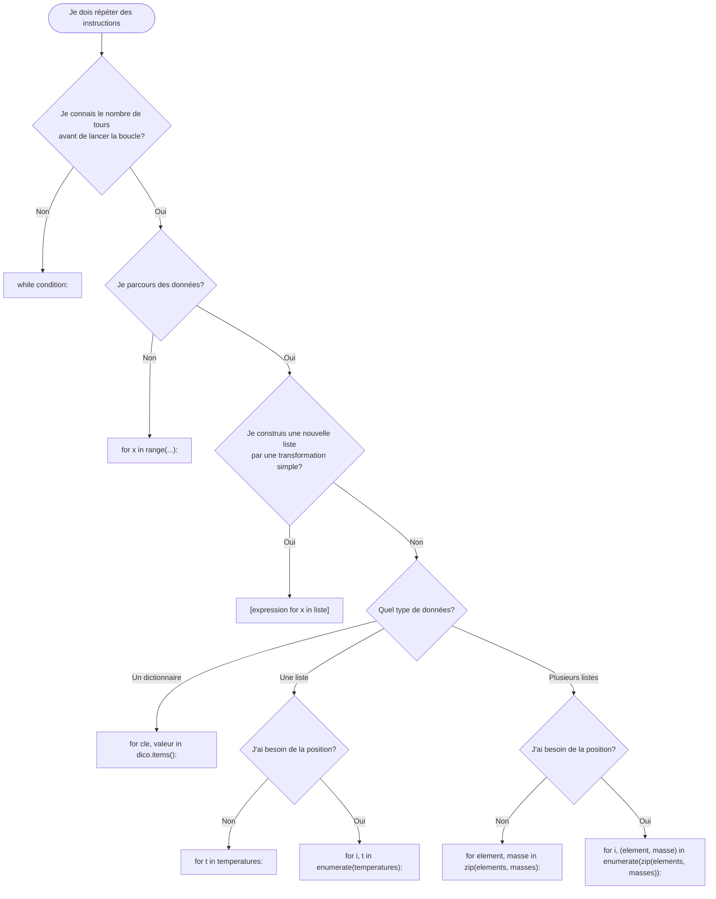

import Tabs from '@theme/Tabs';
import TabItem from '@theme/TabItem';

# 🔁 Structures répétitives

Les structures répétitives permettent d'exécuter un bloc de code plusieurs fois en Python.

---

## 🧭 Choisir sa boucle

Devant un problème, posez-vous les questions de l'arbre **dans l'ordre**, de haut en bas : chaque réponse vous mène à la boucle la plus simple pour ce problème.

<Tabs queryString="boucle">

<TabItem value="r5" label="Jusqu'à la rencontre 5" default>



| Boucle | Quand l'utiliser | Exemple |
|---|---|---|
| `while` | le nombre de tours **dépend de ce qui arrive pendant l'exécution** | redemander une valeur tant qu'elle est invalide |
| `for x in range(...)` | répéter un **nombre de fois connu**, sans données à parcourir | afficher les nombres de 1 à 10 |
| `for t in liste` | lire les **valeurs** d'une liste | compter les fièvres dans `temperatures` |
| `for i in range(len(liste))` | on a besoin de la **position** (l'afficher, modifier la liste) | afficher « Mesure 1 », « Mesure 2 »… |
| `for a, b in zip(liste1, liste2)` | lire **plusieurs listes parallèles** en même temps | afficher chaque élément avec sa masse |

:::note Pour l'instant
Quand on a besoin de la position, on utilise `range(len())` pour l'instant. \
À la [rencontre 9](/cours/rencontre9?onglet=enumerate), la fonction `enumerate()` offrira une façon plus lisible de le faire (voir l'onglet « Version complète »).
:::

👉 Voir aussi : l'onglet [for / range](/cours/rencontre5?onglet=for) (avec l'encadré « `for` ou `while`? Savoir choisir ») et l'onglet [zip](/cours/rencontre5?onglet=zip) de la rencontre 5.

</TabItem>

<TabItem value="r9" label="Version complète (rencontre 9)">



| Boucle | Quand l'utiliser |
|---|---|
| `while` | le nombre de tours dépend de ce qui arrive pendant l'exécution |
| `for x in range(...)` | répéter un nombre de fois connu, sans données à parcourir |
| `[expression for x in liste]` | construire une **nouvelle liste** par une transformation simple (avec un filtre `if` à la fin, au besoin) |
| `for cle, valeur in dico.items()` | parcourir les paires **clé-valeur** d'un dictionnaire |
| `for t in liste` | lire les **valeurs** d'une liste |
| `for i, t in enumerate(liste)` | on a besoin de la **position** et de la valeur |
| `for a, b in zip(liste1, liste2)` | lire **plusieurs listes parallèles** |
| `for i, (a, b) in enumerate(zip(liste1, liste2))` | plusieurs listes parallèles **et** la position |

:::tip `range(len())` reste valide
`for i in range(len(liste))` fonctionne toujours : `enumerate()` et `zip()` sont simplement plus lisibles. Ce n'était pas une « mauvaise » méthode!
:::

👉 Voir aussi : les onglets [enumerate](/cours/rencontre9?onglet=enumerate) et [Compréhension de liste](/cours/rencontre9?onglet=listcomp) de la rencontre 9.

</TabItem>

</Tabs>

---

## 🔹 Boucle `while`

Exécute un bloc tant qu'une condition est vraie.

```python
compteur = 0

while compteur < 3:
    print(compteur)
    compteur += 1
```

---

## 🔹 Boucle `for` — parcours direct

Parcourt directement les valeurs d'une liste (ou d'un tuple), sans avoir besoin de l'index.

```python
temperatures = [21.5, 23.0, 19.8]

for t in temperatures:
    print(t)   # Affiche chaque température
```

---

## 🔹 Boucle `for` — parcours par index avec `range(len(...))`

Utile quand on a besoin de la **position** : pour l'afficher ou pour modifier la liste.

```python
temperatures = [21.5, 23.0, 19.8]

for i in range(len(temperatures)):
    print(f"Mesure {i + 1} : {temperatures[i]}")   # Affiche la position et la valeur
    temperatures[i] = temperatures[i] + 1           # Modifie l'élément à la position i
```

---

## 🔹 Listes parallèles : `zip()`

Parcourt plusieurs listes **en même temps**, élément par élément : chaque tour donne un tuple, déballé dans les variables.

```python
elements = ["Hydrogène", "Oxygène", "Carbone"]
masses = [1.008, 15.999, 12.011]

for element, masse in zip(elements, masses):
    print(f"{element} : {masse} u")
```

⚠️ Si les listes n'ont pas la même longueur, `zip()` s'arrête **sans erreur** à la plus courte.

---

## 🔹 Plage de nombres : `range()`

Génère une séquence de nombres.

```python
# x vaut 0, puis 1, puis 2, puis 3, puis 4 → 5 tours
for x in range(5):
    print(x)
```

```python
# x commence à 1 et s'arrête avant 6 → affiche 1 à 5
for x in range(1, 6):
    print(x)
```

```python
# x avance de 2 en 2 → affiche seulement les pairs
for x in range(0, 11, 2):
    print(x)
```

```python
# step négatif → x descend de 5 jusqu'à 1
for x in range(5, 0, -1):
    print(x)
```

---

## 🔹 Parcours avec index : `enumerate()`

Permet d'obtenir à la fois l'index et la valeur lors d'un parcours.

```python
temperatures = [21.5, 23.0, 19.8]

for i, t in enumerate(temperatures):
    print(i, t)            # 0 21.5, puis 1 23.0, puis 2 19.8

for numero, t in enumerate(temperatures, start=1):
    print(f"Mesure {numero} : {t}")   # La position commence à 1
```

---

## 🔹 Boucles imbriquées

Une boucle peut en contenir une autre. La boucle intérieure s'exécute entièrement à chaque tour de la boucle extérieure.

```python
# Affiche un rectangle de # (largeur x hauteur)
for _ in range(3):          # Boucle pour chaque ligne
    for _ in range(5):      # Boucle pour chaque colonne
        print('#', end='')  # Affiche un # sans saut de ligne
    print()                 # Nouvelle ligne après chaque ligne
```

---

## 🔹 Instructions utiles dans les boucles

| Instruction | Description | Exemple |
|---|---|---|
| `break` | Interrompt la boucle immédiatement | `break` dans un `for` ou `while` |
| `continue` | Passe à l'itération suivante | Saute un tour sans interrompre |
